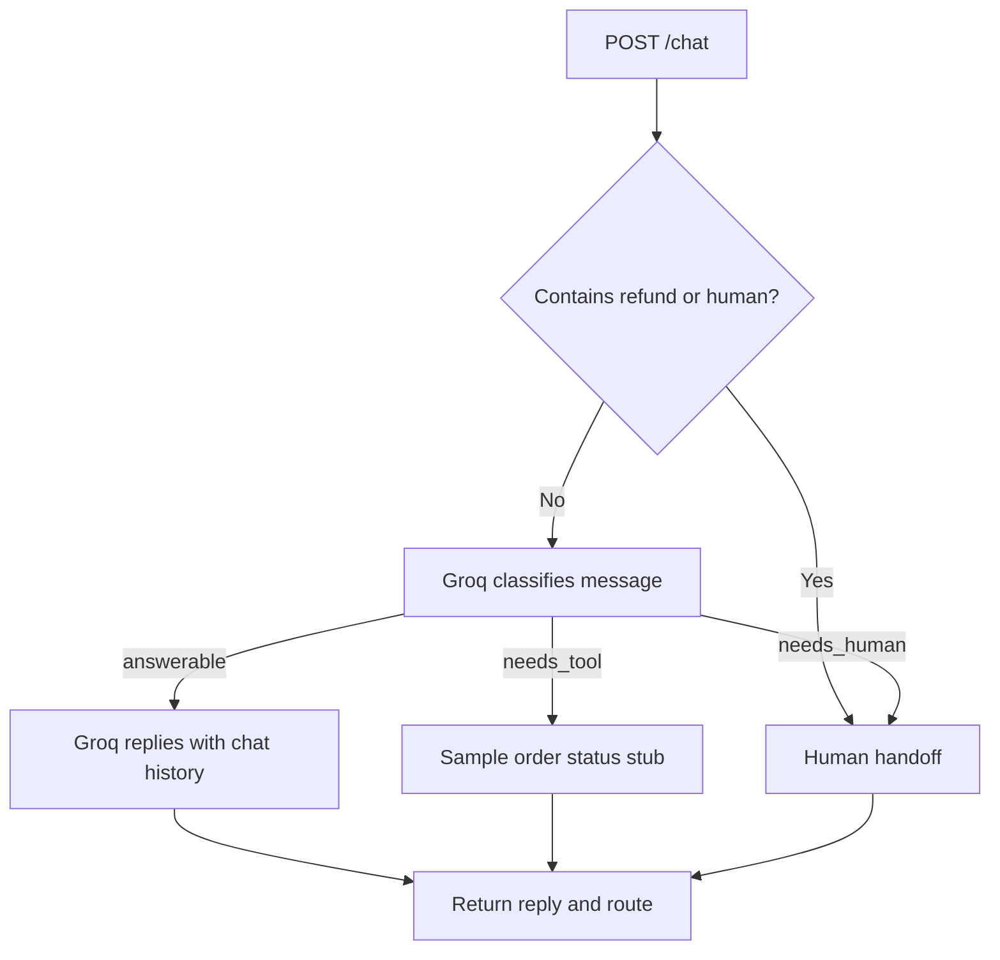

# ✨ Customer Support Agent

A small FastAPI support assistant powered by **Groq** and **LangGraph**. It classifies incoming messages, replies with conversational context, and routes refund or human-agent requests to a handoff.

> Built as a local demo: conversation history is kept in memory, and the order lookup is still a stub.

## What it can do

- **Answer questions** using Groq’s `openai/gpt-oss-120b` model and earlier turns in the conversation.
- **Route messages** through a LangGraph workflow: `answerable`, `needs_tool`, or `needs_human`.
- **Hand off refund requests** and messages containing “human” directly to the human-agent response.
- **Expose a REST API** with interactive Swagger docs.

## How a message flows



## Get started (Windows / PowerShell)

Run these commands from the project folder.

1. **Set up your Groq key.** The app reads `GROQ_API_KEY` from `.env`. If you don’t already have a `.env` file, copy the example; otherwise, edit your existing one without replacing its contents:

   ```powershell
   Copy-Item .env.example .env
   ```

   Add your key to `.env`:

   ```env
   GROQ_API_KEY=your_groq_api_key
   ```

   Get a key from the [Groq Console](https://console.groq.com/keys). Keep it private and don’t commit `.env`.

2. **Install dependencies** (the repository includes a `venv` already):

   ```powershell
   .\venv\Scripts\Activate.ps1
   pip install -r requirements.txt
   ```

3. **Start the development server:**

   ```powershell
   uvicorn main:app --reload
   ```

4. **Open the chat page:** [http://127.0.0.1:8000/chat](http://127.0.0.1:8000/chat). The interactive API docs are at [http://127.0.0.1:8000/docs](http://127.0.0.1:8000/docs).

If port `8000` is unavailable, start with `uvicorn main:app --reload --port 8001` and use `http://127.0.0.1:8001/docs` instead.

## Try the chat endpoint

In `/docs`, expand **POST /chat**, click **Try it out**, and submit:

```json
{
  "conversation_id": "demo-1",
  "message": "Hi, can you help me?"
}
```

A response looks like this:

```json
{
  "reply": "Of course — what can I help you with?",
  "route": "answerable",
  "escalated": false
}
```

Use the same `conversation_id` for follow-up messages so the assistant can use earlier turns as context. A refund message returns the handoff response with `route` set to `needs_human` and `escalated` set to `true`.

### Routes

| Route | What happens |
| --- | --- |
| `answerable` | Groq writes a reply using the conversation history. |
| `needs_tool` | Returns a sample shipped-order status; no real order system is connected yet. |
| `needs_human` | Returns a handoff message. Refund requests and messages containing “human” take this path directly. |

## Project layout

```text
.
├── main.py          # FastAPI app and LangGraph workflow
├── chat.html        # Browser-based chat interface
├── requirements.txt # Python dependencies
├── .env.example     # Environment-variable template
└── README.md
```

## Current limitations

- Conversation history is stored in process memory and is cleared when the app restarts.
- The order-status tool is a placeholder, not a live lookup.
- `DATABASE_URL` is present in the environment template for future persistence work; the app does not currently connect to Postgres.
- Normal chat needs a valid `GROQ_API_KEY`. Without it, the API returns a configuration error; the direct handoff path does not call Groq.
